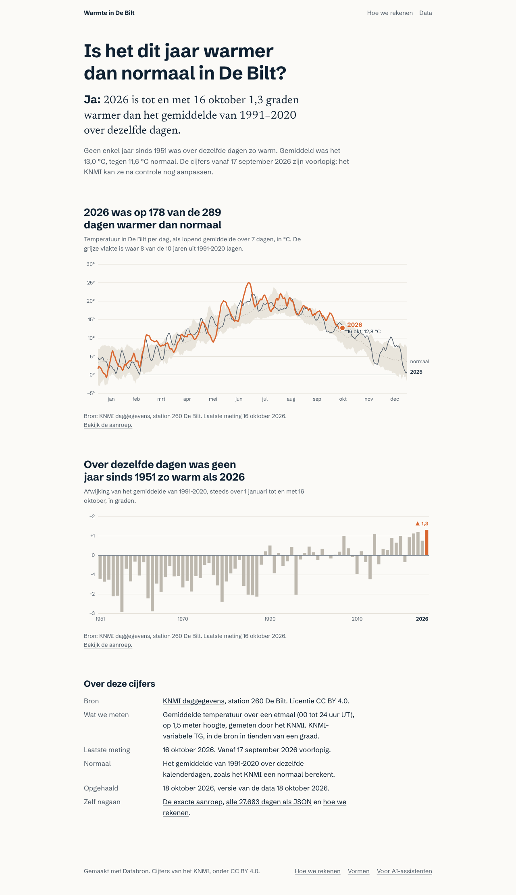

# Warmte in De Bilt

Een kleine site die één vraag beantwoordt: **is het dit jaar warmer dan normaal in De Bilt?** Elke ochtend haalt een
GitHub Action de daggegevens van het KNMI op, controleert ze en zet de nieuwe stand in deze repo. De site rekent het
antwoord uit en toont het met twee grafieken.

Dit is het startsjabloon van [Databron](https://www.opendataindex.nl): vind een bron in Open Data Index, bouw er met
Databron een dataset, grafiek en site van. De KNMI-bron is een voorbeeld dat meteen werkt; de Databron-skills
vervangen hem door jouw eigen bron en vraag.



## De drie commando's

```
pnpm install
pnpm oogst     # haalt de data op naar data/ (eerste keer: alles vanaf 1951, ongeveer 20 seconden)
pnpm dev       # de site op http://localhost:3481
```

Daarnaast: `pnpm toets` (de controle vóór publicatie, schrijft `toets/rapport.md`), `pnpm test`, `pnpm typecheck` en
`pnpm build`. Je hebt Node 24 en pnpm nodig.

## Hoe het werkt

1. **Ophalen** (`oogst/`): de KNMI-aanroep in stukken van vijf jaar, met een eerlijke user-agent, time-outs en nieuwe
   pogingen. Een waakhond weigert verse data die korter, ouder of leger is dan de vorige goede stand.
2. **Opslaan** (`data/`): dezelfde indeling als een Databron-database (maten, entiteiten, waarnemingen met een
   checksum), maar als bestanden. Git is de geschiedenis: elke dag één commit, `git log -p data/` laat zien wat het
   KNMI veranderde.
3. **Toetsen** (`toets/`): dekking, grenzen, versheid, drift tegenover de vorige versie, leeg blijft leeg, en klopt
   de antwoordzin met de cijfers. Faalt er iets, dan wordt er niets gecommit.
4. **Rekenen en schrijven** (`lib/reken.ts`, `lib/duid.ts`): één afleidfunctie voor alles wat de site toont; elke zin
   wordt uit de cijfers gemaakt.
5. **Tonen** (`components/beeld/`, `app/`): grafieken als SVG op de server, een deelbeeld, `llms.txt` voor
   AI-assistenten en de data als download op `/data/tg`.

Meer over de vraag staat in `vraag.md`, over de bron in `bronnen/knmi-daggegevens.md`, en over de stand van het
project in `STAND.md`.

## Publiceren

### Op Vercel (standaard)

1. Zet de repo op GitHub: `git init && git add . && git commit -m "start"`, dan
   `gh repo create <naam> --private --source . --push`. De map `data/` gaat mee: zo toont de eerste deploy al een grafiek.
2. Koppel hem in Vercel (Add New, Project, kies de repo) of met `vercel link` en `vercel deploy --prod`.
   Er zijn geen geheimen nodig. `SITE_URL` hoeft niet: Vercel geeft het productiedomein zelf door.
3. Elke push naar `main` is een nieuwe productieversie, ook de dagelijkse datacommit van de Action.

### Op Cloudflare (alternatief)

De configuratie staat klaar (`open-next.config.ts`, `wrangler.jsonc`), maar het pakket zit er niet standaard in:

```
pnpm add -D @opennextjs/cloudflare wrangler
pnpm exec opennextjs-cloudflare build
pnpm exec opennextjs-cloudflare preview     # lokaal proberen
pnpm exec opennextjs-cloudflare deploy      # na wrangler login
```

Zet `SITE_URL` in de omgeving waarin je bouwt (de pagina's worden bij de build gemaakt), anders wijzen sitemap en
deelbeeld naar localhost. Alle pagina's zijn
statisch, dus de beperkingen van Workers raken de site niet; de oogst draait in GitHub Actions, niet bij Cloudflare.
Test een eerste deploy wel zelf: dit sjabloon is lokaal gebouwd en getest, maar nog niet op Cloudflare gedeployed.

### De dagelijkse oogst

`.github/workflows/oogst.yml` draait elke dag om 06:30 UTC en kan ook met de hand (Actions, oogst, Run workflow,
eventueel met "Alles vanaf 1951 opnieuw ophalen"). Hij vraagt zelf schrijfrechten (`permissions: contents: write`); staat je organisatie
dat niet toe, zet het dan aan onder Settings, Actions, General, Workflow permissions. In een openbare repo zet GitHub geplande
workflows uit na 60 dagen zonder activiteit; de dagelijkse commit houdt hem wakker.

## Fouten en bronnen melden

Klopt een cijfer niet, open dan een issue met "Fout in een cijfer melden". Een bron voorstellen kan met "Nieuwe bron
toevoegen".

## Licentie van de data

De cijfers zijn van het KNMI, onder CC BY 4.0. Vermeld het KNMI als je ze hergebruikt.
